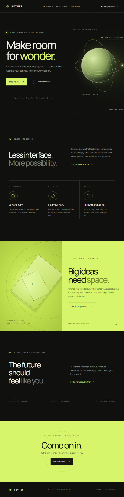

# Aether

Aether is a responsive landing page concept for a fictional spatial-computing experience. It pairs a dark editorial layout and lime accents with a luminous animated globe, orbiting rings, and a subtle Three.js star field.

The page is built with semantic HTML, plain CSS, and vanilla JavaScript. No build step or package installation is required.

## Preview



## Run locally

The page uses JavaScript modules, so open it through a local HTTP server rather than directly as a `file:` URL.

### Python

From the project directory, run:

```powershell
python -m http.server 8000
```

Then open [http://localhost:8000](http://localhost:8000).

### Node.js

If Node.js is installed, you can use:

```powershell
npx serve .
```

Open the local URL printed by the server.

There are no project dependencies to install. The Three.js module and Manrope/DM Mono fonts are loaded from CDNs, so an internet connection is needed for those assets. The CSS globe and its animations work without the Three.js module or WebGL.

## Features

- Animated globe with rotating surface lines, elliptical orbital rings, and a circling satellite.
- Three.js particle field for additional depth when the module and WebGL are available.
- CSS globe fallback that remains visible if WebGL is unavailable or the Three.js CDN cannot be reached.
- Responsive layouts for desktop and mobile, including a collapsible mobile navigation menu.
- Reduced-motion support for visitors who prefer less animation.
- Semantic page sections, descriptive navigation labels, and a descriptive label for the animated artwork.
- Early-access call to action using an email link.

## Project files

| File | Description |
| --- | --- |
| `index.html` | Page content and structure, font stylesheets, and the Three.js import map. |
| `styles.css` | Visual design, responsive breakpoints, globe artwork, animations, and reduced-motion styles. |
| `main.js` | Three.js star field, animation loop, WebGL error handling, and mobile menu interactions. |
| `screenshot.png` | Full-page desktop screenshot of the landing page. |

## Page sections

1. **Hero** — introductory message, calls to action, and animated globe artwork.
2. **Experience** — introduction to the product concept and three feature highlights.
3. **Possibilities** — a contrasting lime-green feature section.
4. **Details** — product design principles.
5. **Waitlist** — early-access call to action.
6. **Footer** — wordmark and closing details.

## Customization

- Edit the copy, navigation, and section structure in `index.html`.
- Adjust colors, typography, spacing, responsive behavior, and globe animation in `styles.css`.
- Adjust the Three.js particle field and mobile navigation behavior in `main.js`.
- The current waitlist button opens a prefilled email to `hello@aether.example`. Replace this placeholder with a real signup form or contact address before publishing.

## Browser and motion notes

Use a current browser with JavaScript enabled. The Three.js star field needs WebGL; if it cannot initialize, the CSS globe remains visible. The page observes the operating system's reduced-motion preference and reduces or stops decorative animation accordingly.
